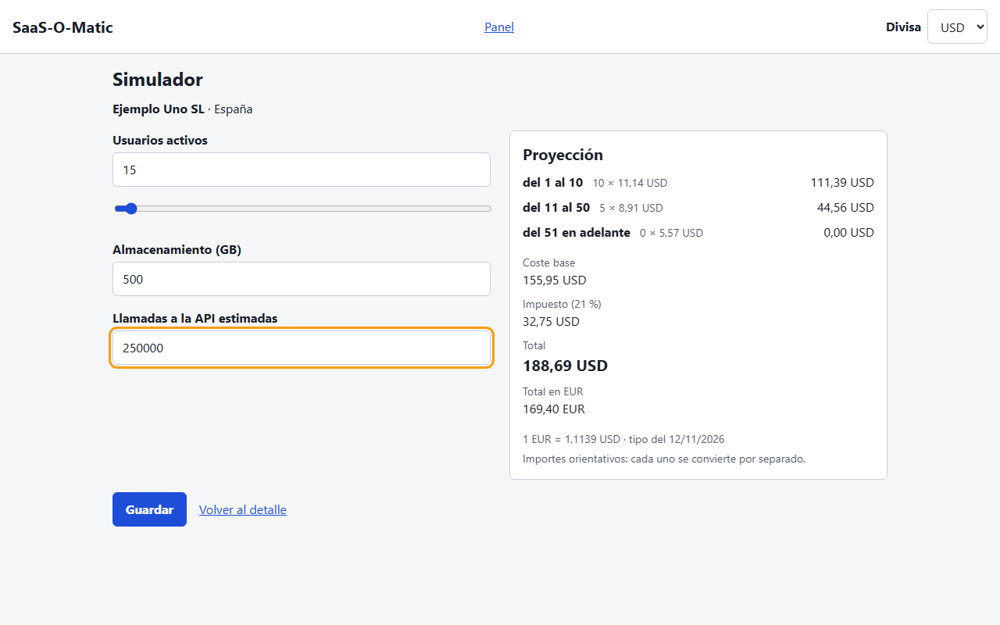

# SaaS-O-Matic

[](https://github.com/JuakiiG/saas-o-matic/actions/workflows/ci.yml)

Herramienta interna para que un equipo comercial simule y presupueste
suscripciones SaaS: tarificación por tramos, impuestos por país e importes
en varias divisas. Una API REST (FastAPI y SQLite) y un panel web (Angular).



## Requisitos

Probado a mano con estas versiones, y solo con ellas:

| Herramienta | Versión |
|---|---|
| Windows 11 | 10.0.26300 |
| [uv](https://docs.astral.sh/uv/) | 0.12.13 |
| Python | 3.12.0 (el proyecto pide 3.12; `uv` lo descarga si falta) |
| Node.js y npm | 24.18.0 y 11.16.0 |
| git | 2.55.0 |

Además, la integración continua ejecuta el oráculo con `--e2e` en Linux y
en Windows Server, con las mismas versiones de uv, Node.js y npm y sin
nadie mirando un navegador. En macOS no se ha probado nunca (ver
«Límites»).

## Arranque

El backend, en una terminal:

```
cd backend
uv run --locked uvicorn --factory app.main:create_app
```

Escucha en `http://127.0.0.1:8000`. **La primera vez** `uv` crea el entorno
con las dependencias y el backend crea la base de datos, vacía, en
`backend/data/saas-o-matic.db`; después conserva lo guardado. Para empezar
de cero, parar el backend y borrar ese fichero.

El frontend, en otra terminal:

```
cd frontend
npm ci
npm start
```

Abrir **`http://localhost:4200`**, y solo esa dirección: es el único origen
que el backend admite por defecto (CORS). `http://127.0.0.1:4200` ni
siquiera carga (visto en Windows 11: «No se puede acceder a este sitio
web»), porque `ng serve` escucha solo en `[::1]:4200`. Desde otro origen
que sí cargue, como `http://[::1]:4200`, la aplicación se abre, pero el
navegador oculta las respuestas del backend y se ve «No se ha podido
conectar con el servidor.».

`npm ci` termina con dos avisos que no impiden nada: los de `npm audit`
(ver «Límites») y cuatro paquetes con scripts de instalación sin aprobar.

## Datos para probar

Con la base vacía, «Dar de alta el primer cliente». El nombre es libre y el
email solo tiene que tener forma de email (`pruebas@empresa.example`). Un
identificador fiscal válido de cada país:

| País | Identificador |
|---|---|
| España | `B12345674` |
| Portugal | `501234567` |
| Francia | `12345678901` |
| Alemania | `123456789` |
| Italia | `12345678901` |
| Países Bajos | `123456789B01` |
| Irlanda | `1234567WA` |
| Bélgica | `0123456789` |
| Reino Unido | `123456789` |

En España se comprueba el carácter de control (DNI, NIE y CIF: también
valen `12345678Z` y `X1234567L`; `B12345675` da error). En los demás
países vale cualquier texto de 4 a 20 letras o cifras. Un mismo
identificador no se puede repetir dentro de un país.

## Tests y oráculo

El oráculo ejecuta tests, lint, tipos, cobertura, límites de tamaño y el
control de specs. Se lanza desde la raíz del repositorio, no desde
`frontend/`, que es donde deja «Arranque», y **necesita antes el `npm ci`
del frontend**:

```
# en la raíz del repositorio (desde frontend/: cd ..)
uv run scripts/check.py
```

Con `--e2e` añade las pruebas de principio a fin, con Playwright, que
necesita antes su navegador, una sola vez:

```
# desde la raíz del repositorio
cd frontend
npx playwright install --only-shell chromium
cd ..
```

Y entonces:

```
# en la raíz del repositorio
uv run scripts/check.py --e2e
```

- **Qué descarga**: Chromium sin ventana, de `cdn.playwright.dev`: 131 MB,
  304 MB en disco, en la carpeta `ms-playwright` del usuario, fuera del
  repositorio.
- **Usan los puertos 8000 y 4200**: arrancan su propio backend, con una
  base de datos temporal, y su propio frontend. Hay que parar antes los
  servidores que estén abiertos: con un puerto ocupado fallan sin tocar
  nada.
- **Solo funcionan en Chromium.**

La integración continua
([`.github/workflows/ci.yml`](.github/workflows/ci.yml)) ejecuta esa misma
orden, con `--e2e`, en Linux y en Windows, en cada `push` y en cada
*pull request*: es la insignia de debajo del título.

Tests que hay hoy (2026-11-16): 741 del backend, 569 del frontend, 18 de
Playwright y 96 de los propios scripts. Por separado:
`uv run --locked pytest` en `backend/`; `npm run test:ci` y `npm run e2e`
en `frontend/`.

## Configuración

Variables de entorno del backend. El frontend no lee ninguna: sus dos
direcciones están en `frontend/src/environments/`.

| Variable | Por defecto | Qué es |
|---|---|---|
| `DATABASE_PATH` | `backend/data/saas-o-matic.db` | Fichero de la base de datos. Se crea si no existe |
| `CORS_ORIGINS` | `http://localhost:4200` | Orígenes admitidos, separados por comas |

## Qué necesita internet

- **Los tipos de cambio**: el navegador los pide a `api.frankfurter.dev` al
  abrir la aplicación. Si falla o tarda más de 5 s, la cabecera lo avisa,
  con «Reintentar», y los importes se ven solo en EUR. Todo lo demás
  funciona igual.
- **`http://127.0.0.1:8000/docs`**: la página carga su interfaz de
  `cdn.jsdelivr.net`. Sin conexión queda en blanco; `/openapi.json` no la
  necesita.
- La instalación: `uv`, `npm ci` y el navegador de Playwright.

## Límites

Lo que el sistema no hace, o hace de forma imperfecta, está en
[`limitaciones-conocidas.md`](ai-workspace/04-calidad/limitaciones-conocidas.md).
Además:

- **A mano, solo se ha probado en Windows 11.** En Linux (Ubuntu 26.04) y
  en Windows Server 2025 solo se ha ejecutado el oráculo con `--e2e`, en
  la integración continua (primera ejecución, 2026-11-17, en verde), sin
  nadie mirando un navegador. **En macOS no se ha ejecutado nunca.**
- **`npm audit` da 27 avisos de gravedad moderada** (2026-11-15), todos en
  herramientas de desarrollo; nada de eso llega al navegador (L-07).
- **Dos ejecuciones de Playwright a la vez se estorban**: la segunda falla
  por los puertos y además hace fallar a la primera.
- **En otra divisa, la base más el impuesto puede diferir del total en un
  céntimo**: cada importe se convierte por separado, y la interfaz avisa de
  que son orientativos. En EUR los importes son exactos.

## Cómo se ha hecho

Con especificaciones antes que código, TDD y una IA dirigida y auditada. El
análisis, las specs, las decisiones de arquitectura, la bitácora de cada
sesión y las evaluaciones independientes están en
[`ai-workspace/`](ai-workspace/README.md), que es por donde conviene empezar
a leer. Las conversaciones con la IA están
[publicadas](ai-workspace/03-proceso/conversaciones/README.md), y el método,
con sus dos sesiones de IA, está explicado en
[`ai-workspace/README.md`](ai-workspace/README.md#dos-sesiones-de-ia-y-una-persona).

| Carpeta | Contenido |
|---|---|
| [`ai-workspace/`](ai-workspace/README.md) | Análisis, specs, arquitectura, bitácora y calidad |
| `backend/` | API REST y base de datos |
| `frontend/` | Panel comercial |
| `scripts/` | El oráculo y las herramientas del repositorio |
